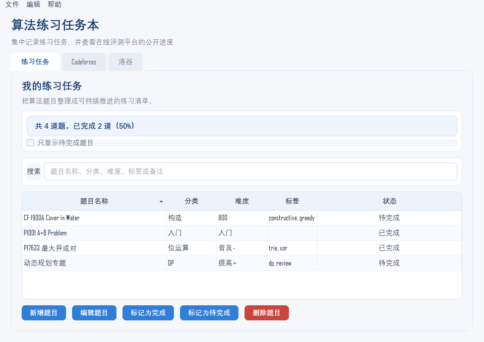

# Algorithm Practice Notebook

一个为算法学习者准备的 Qt 6 桌面任务本。它帮助你记录正在练习的题目、标记完成状态，并查看公开的 Codeforces 和洛谷账号进度。



## 本项目能做什么？

- 在桌面界面中新增、编辑、删除练习题，并标记完成或待完成。
- 支持标签和备注，可按标签/备注搜索；支持 `Ctrl+N` 新增、`Ctrl+F` 搜索、`Delete` 删除、`Ctrl+Z` 撤销最近一步。
- 支持把任务导出为 CSV（含标签/备注），也可从旧版 4 列 CSV 或新版 6 列 CSV 导入。
- “文件 → 从备份恢复…”可用 `.bak` 恢复上一版任务数据。
- 筛选待完成题目，并查看完成数量。
- 使用 JSON v2 保存到用户数据目录，保存时保留上一版 `.bak` 备份；旧版 `tasks.txt` 会自动迁移。
- 题目名称、分类、难度、标签或备注里包含 Tab、换行等字符时也能正确保存。
- 输入 Codeforces handle 后查看等级、当前/最高 rating、最近提交和最近 1000 次提交里的不同 AC 题数。
- 输入洛谷用户名或 UID 后查看公开资料、通过题数、提交题数、等级分与关注统计。
- 使用统一的卡片、标签页、按钮与表格样式，便于切换和阅读信息。

## 环境准备与下载

Windows 用户可从以下官方页面安装所需工具：

- [g++（MSYS2 / MinGW-w64）](https://www.msys2.org/)：安装 MSYS2 后，在 UCRT64 终端执行 `pacman -S mingw-w64-ucrt-x86_64-gcc`。
- [Qt 6 开源版](https://www.qt.io/download-open-source)：安装时选择 Qt 6.5 或更新版本的 MinGW 套件，并让它与 g++ 的架构一致。请确认安装 Qt Network 模块。
- [CMake](https://cmake.org/download/)：下载 Windows 安装程序；安装时勾选将 CMake 加入系统 `PATH`。

安装后重新打开终端，分别运行 `g++ --version`、`cmake --version`，确认命令可用。

## 构建与运行

在项目根目录运行：

```powershell
cmake -S . -B build -DBUILD_TESTING=ON
cmake --build build
ctest --test-dir build --output-on-failure
.\build\task_notebook_gui.exe
```

如果使用 Visual Studio 多配置生成器，构建和运行时请加 `--config Release`，测试时加 `-C Release`。

## 数据保存在哪里

默认保存在当前用户的应用数据目录：

```text
%APPDATA%\chenyuwen\AlgorithmPracticeNotebook\tasks.json
```

- 首次启动时，如果 `tasks.json` 不存在，程序会自动把旧 `tasks.txt` 迁移为 JSON，旧文件保留不删除。
- 如果 AppData 不可写，程序会自动降级到程序所在目录或临时目录，并提示实际数据位置。
- 如果主文件缺失但 `tasks.json.bak` 存在，会先尝试从备份恢复。
- 每次保存会先把上一版保留为 `tasks.json.bak`，再原子替换 `tasks.json`。
- 使用 `task_notebook_gui.exe --portable` 可以把数据放在 exe 同目录，便于 U 盘或绿色版使用。

## 在线账号查询

在“Codeforces”标签页输入公开 handle 即可查看资料和最近提交。Codeforces API 每两秒最多允许一次请求，程序会在两次查询之间等待。AC 题数按最近 1000 次提交计算，完整历史可能超出统计范围；最近提交列表显示最多 20 条。

在“洛谷”标签页输入用户名或 UID 即可查看公开账号资料。当前可显示通过题数、提交题数、等级分和关注数据。洛谷可能要求登录后才能查看他人的提交明细，因此本项目不会显示受限制的记录，也不会请求、保存或传输账号密码。公开资料中缺失的字段会显示“未公开”。

Codeforces 官方 API 文档：[方法说明](https://codeforces.com/apiHelp/methods) · [API 使用说明](https://codeforces.com/apiHelp/)

## 隐私与数据

- 任务数据只保存在本机；默认位置见“数据保存在哪里”，不会上传。
- 查询时只向 Codeforces / 洛谷发送你输入的公开账号标识，不发送任务内容。
- 不收集遥测，不保存账号密码、Cookie 或登录凭据。
- 洛谷接口是非官方接口，字段和访问策略可能变化；缺失字段会显示“未公开”。

## 已知限制

- Codeforces 的通过题数只统计最近 1000 次提交，不能代表完整历史。
- 洛谷提交明细可能要求登录，本项目不读取受限制的数据。
- Codeforces API 每两秒最多一次请求；连续查询多个账号时可能需要等待。

## 打包便携版

推荐直接运行：

```powershell
.\scripts\package.ps1
```

脚本会执行 CMake 安装、`windeployqt`、补齐 MinGW/第三方依赖 DLL，并生成 `task_notebook_gui-windows.zip`。目标机器不需要安装 Qt 或 MSYS2。

如果手工打包，至少需要：

```powershell
cmake --install build --prefix dist --config Release
windeployqt --release --no-translations --compiler-runtime dist\task_notebook_gui.exe
```

注意：MinGW 构建时 `windeployqt` 不一定复制 `libgcc`、`libstdc++`、ICU 等依赖，建议使用脚本。

## 后续规划

项目评估、分阶段路线图与技术演进方案见 [docs/ROADMAP.md](docs/ROADMAP.md)；发布前检查见 [docs/RELEASE.md](docs/RELEASE.md)；参与贡献见 [CONTRIBUTING.md](CONTRIBUTING.md)。

## 许可证

本项目使用 MIT 许可证，详见 [LICENSE](LICENSE)。

## 第三方组件

- Qt 6（Widgets / Network / Test）按 LGPLv3 使用；分发二进制时请遵守 Qt 的许可要求，并随包附上 Qt 许可文本。
- Codeforces API 与洛谷公开接口仅用于读取公开数据，接口归属各自平台。

## 文件结构

```text
.
├── gui/main.cpp                   # Qt 桌面界面与在线账号查询
├── src/app_paths.*                # 数据目录、迁移与备份恢复
├── src/json_task_store.*          # JSON v2 任务存储与备份
├── src/task_export.*              # CSV 导出/导入
├── src/task_history.*             # 撤销快照栈
├── src/task_store.*               # 旧版 TSV 读取/迁移
├── src/task_table_model.*         # 任务表模型与筛选代理
├── src/version.h.in               # CMake 生成的版本头模板
├── tests/test_task_store.cpp      # 旧版 TSV 存储测试（Qt Test）
├── tests/test_json_task_store.cpp # JSON v2 存储测试（Qt Test）
├── tests/test_app_paths.cpp       # 数据目录/迁移测试（Qt Test）
├── tests/test_task_export.cpp     # CSV 导出/导入测试（Qt Test）
├── tests/test_task_history.cpp    # 撤销栈测试（Qt Test）
├── tests/test_task_table_model.cpp # 模型/筛选/排序测试（Qt Test）
├── scripts/package.ps1            # 便携版打包脚本
├── docs/ROADMAP.md                # 项目评估与后续发展规划
├── docs/RELEASE.md                # 发布检查清单
├── docs/screenshot.png            # 界面截图
├── CHANGELOG.md                   # 版本变化记录
├── CONTRIBUTING.md                # 贡献指南
├── LICENSE                        # MIT 许可证
├── CMakeLists.txt                 # 构建配置
├── README.md
└── .gitignore
```
